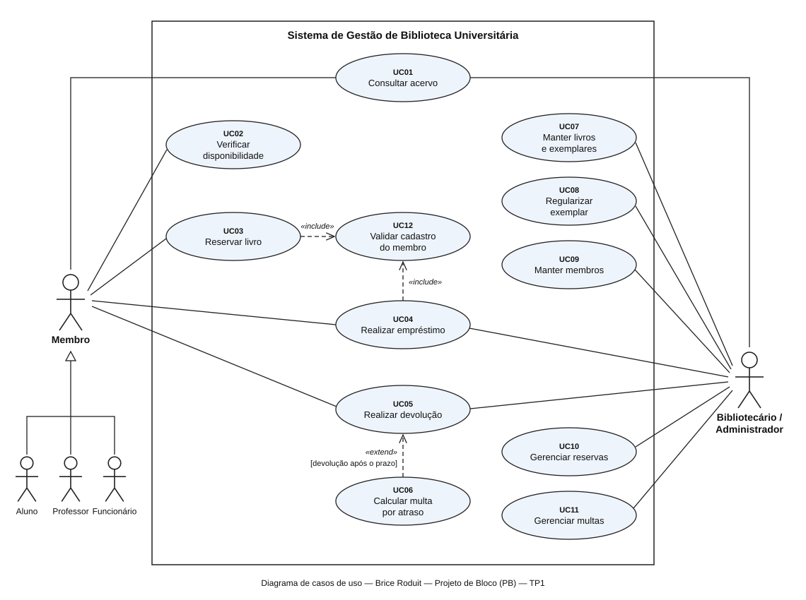

# Sistema de Gestão de Biblioteca Universitária

**Documento de requisitos, casos de uso e escopo do TP1**

Aluno: Brice Roduit  
Disciplina: Projeto de Bloco (PB)  
Trilha escolhida: C# (.NET 10)

## 1. Visão geral

O sistema controla o acervo de uma biblioteca universitária, os membros e a circulação dos
exemplares: consulta, empréstimo, devolução, reserva e multa por atraso.

Há dois atores:

| Ator | O que faz |
|---|---|
| Membro (aluno, professor ou funcionário) | Consulta o acervo, verifica disponibilidade, solicita empréstimos e devoluções e faz reservas |
| Bibliotecário/Administrador | Cuida dos cadastros, processa empréstimos e devoluções e gerencia reservas e multas |

E seis entidades:

| Entidade | Dados |
|---|---|
| Livro | título, autor, ISBN |
| Exemplar | código de patrimônio, estado de conservação, livro |
| Membro | nome, matrícula, tipo |
| Empréstimo | exemplar, membro, data de retirada, prazo, data efetiva de devolução |
| Reserva | livro, membro, data da reserva |
| Multa | membro, empréstimo, valor, situação de pagamento |

## 2. Regras de negócio

São as regras da especificação, na mesma ordem, numeradas para serem citadas nos requisitos.

| ID | Regra |
|---|---|
| RN01 | O prazo do empréstimo é de 14 dias corridos a partir da retirada. |
| RN02 | A multa é calculada por dia corrido de atraso, até a devolução efetiva. |
| RN03 | Cada membro pode ter no máximo 3 empréstimos ativos. |
| RN04 | Só se empresta exemplar disponível e em condições adequadas de uso. |
| RN05 | Um exemplar tem no máximo um empréstimo ativo. |
| RN06 | Só se reserva livro que tenha exemplar emprestado. Com todos disponíveis, não há reserva. |
| RN07 | A reserva é do livro, e não de um exemplar. |
| RN08 | A devolução encerra o empréstimo ativo e registra a data efetiva. |
| RN09 | Na devolução atrasada, a multa é calculada e vinculada ao membro do empréstimo. |
| RN10 | Exemplar danificado ou indisponível não é emprestado até o bibliotecário regularizar. |
| RN11 | Só o Bibliotecário/Administrador altera acervo e membros, processa operações administrativas e gerencia multas. |
| RN12 | Só membro com cadastro válido faz empréstimos e reservas. |

## 3. Requisitos funcionais

Prioridade: **alta** é o que faz a biblioteca funcionar, **média** completa o controle e
**baixa** é apoio. A coluna TP1 diz o que o programa inicial já exercita: "regra" significa que
a conta ou a decisão existe, mas com dados digitados na hora, sem cadastro.

| ID | Requisito | Categoria | Prioridade | Origem | TP1 |
|---|---|---|---|---|---|
| RF01 | Cadastrar, consultar, atualizar e remover livros | Acervo | Alta | RN11 | não |
| RF02 | Cadastrar, consultar, atualizar e remover exemplares vinculados a um livro | Acervo | Alta | RN11 | não |
| RF03 | Alterar o estado de conservação e regularizar exemplares danificados ou indisponíveis | Acervo | Média | RN10, RN11 | não |
| RF04 | Consultar o acervo por título, autor ou ISBN | Acervo | Alta | Especificação (papéis) | não |
| RF05 | Mostrar quantos exemplares de um livro estão disponíveis | Acervo | Alta | Especificação (papéis) | não |
| RF06 | Cadastrar, consultar, atualizar e remover membros | Membros | Alta | RN11 | não |
| RF07 | Verificar se o membro tem cadastro válido antes de emprestar ou reservar | Membros | Alta | RN12 | regra |
| RF08 | Registrar empréstimo de um exemplar para um membro | Circulação | Alta | RN04, RN05 | regra |
| RF09 | Calcular o prazo de devolução | Circulação | Alta | RN01 | regra |
| RF10 | Recusar empréstimo quando o membro já tem 3 ativos | Circulação | Alta | RN03 | regra |
| RF11 | Recusar empréstimo de exemplar indisponível, já emprestado ou danificado | Circulação | Alta | RN04, RN05, RN10 | regra |
| RF12 | Registrar a devolução, encerrando o empréstimo com a data efetiva | Circulação | Alta | RN08 | regra |
| RF13 | Calcular a multa na devolução atrasada | Multas | Alta | RN02, RN09 | regra |
| RF14 | Vincular a multa ao membro e ao empréstimo | Multas | Alta | RN09 | não |
| RF15 | Consultar multas e registrar o pagamento | Multas | Média | RN11 | não |
| RF16 | Registrar reserva de um livro para um membro | Reservas | Alta | RN06, RN07 | regra |
| RF17 | Recusar reserva de livro sem exemplar emprestado | Reservas | Alta | RN06 | regra |
| RF18 | Consultar e cancelar reservas | Reservas | Média | Especificação (papéis) | não |
| RF19 | Informar o motivo sempre que uma operação for recusada | Circulação | Média | Suposição S10 | regra |
| RF20 | Identificar o usuário e permitir operações administrativas só ao bibliotecário | Acesso | Alta | RN11 | não |
| RF21 | Mostrar um resumo das operações | Apoio | Baixa | Suposição S11 | regra |

## 4. Requisitos não funcionais

Os números de desempenho são metas minhas, porque a especificação não traz nenhum.

| ID | Requisito | Categoria | Prioridade | Etapa |
|---|---|---|---|---|
| RNF01 | Ser escrito em C# com .NET 10 | Restrição técnica | Alta | TP1 em diante |
| RNF02 | Rodar no console como programa standalone, sem banco nem rede | Restrição técnica | Alta | TP1 |
| RNF03 | Evoluir para serviço web com ASP.NET Core e API | Restrição técnica | Alta | Próximas entregas |
| RNF04 | Guardar os dados entre execuções | Persistência | Alta | Próximas entregas |
| RNF05 | Exigir autenticação e separar os perfis Membro e Bibliotecário | Segurança | Alta | Próximas entregas |
| RNF06 | Usar mensagens em português e datas no formato dd/mm/aaaa | Usabilidade | Média | TP1 em diante |
| RNF07 | Não encerrar com erro por entrada inválida: avisar e perguntar de novo | Confiabilidade | Alta | TP1 em diante |
| RNF08 | Calcular valores em dinheiro com tipo decimal | Confiabilidade | Alta | TP1 em diante |
| RNF09 | Responder consultas ao acervo em até 2 segundos com 10 mil livros | Desempenho | Média | Próximas entregas |
| RNF10 | Manter prazo, limite e valor da multa em um único lugar do código | Manutenção | Média | TP1 em diante |

## 5. Casos de uso

### 5.1 Diagrama



Aluno, Professor e Funcionário são especializações de Membro, porque a especificação dá as
mesmas permissões e limites aos três. Empréstimo e devolução têm os dois atores: o membro
solicita e o bibliotecário processa. A multa é um `extend` porque só acontece quando há atraso,
e a validação do cadastro é um `include` porque é obrigatória no empréstimo e na reserva.

### 5.2 Lista

| ID | Caso de uso | Atores | Requisitos |
|---|---|---|---|
| UC01 | Consultar acervo | Membro, Bibliotecário | RF04 |
| UC02 | Verificar disponibilidade | Membro | RF05 |
| UC03 | Reservar livro | Membro | RF16, RF17, RF19 |
| UC04 | Realizar empréstimo | Membro, Bibliotecário | RF08 a RF11, RF19 |
| UC05 | Realizar devolução | Membro, Bibliotecário | RF12 |
| UC06 | Calcular multa por atraso | (estende UC05) | RF13, RF14 |
| UC07 | Manter livros e exemplares | Bibliotecário | RF01, RF02 |
| UC08 | Regularizar exemplar | Bibliotecário | RF03 |
| UC09 | Manter membros | Bibliotecário | RF06 |
| UC10 | Gerenciar reservas | Bibliotecário | RF18 |
| UC11 | Gerenciar multas | Bibliotecário | RF15 |
| UC12 | Validar cadastro do membro | (incluído em UC03 e UC04) | RF07 |

RF20 (acesso) vale para todos os casos e entra como pré-condição. RF21 (resumo) é uma função de
apoio do programa do TP1 e não virou caso de uso.

### 5.3 UC04 - Realizar empréstimo

**Atores:** Membro (solicita) e Bibliotecário (processa)  
**Pré-condições:** o bibliotecário está identificado; o livro e o exemplar estão cadastrados.  
**Pós-condição:** existe um empréstimo ativo e o exemplar deixa de estar disponível.

Fluxo principal:

1. O membro solicita o empréstimo de um exemplar.
2. O bibliotecário informa a matrícula e o código de patrimônio.
3. O sistema valida o cadastro do membro (UC12).
4. O sistema verifica que o membro tem menos de 3 empréstimos ativos (RN03).
5. O sistema verifica que o exemplar está disponível e em condições de uso (RN04, RN05, RN10).
6. O sistema registra a retirada e calcula o prazo de 14 dias corridos (RN01).
7. O sistema mostra a data limite de devolução.

Fluxos alternativos:

Se algo falhar nos passos 3 a 5, o sistema ainda faz as outras verificações. Depois recusa o
empréstimo, mostra todos os motivos juntos (suposição S10) e não registra nada.

- **A1 - Cadastro inválido (passo 3):** o motivo é a falta de cadastro válido.
- **A2 - Limite atingido (passo 4):** o motivo é o membro já ter 3 empréstimos ativos.
- **A3 - Exemplar já emprestado (passo 5):** o motivo é o exemplar indisponível. O bibliotecário pode
  escolher outro exemplar do mesmo livro, voltando ao passo 2, ou o membro pode reservar o livro (UC03).
- **A4 - Exemplar danificado (passo 5):** o motivo é a condição do exemplar, que só volta a ser
  emprestado depois de regularizado (UC08).

### 5.4 UC05 - Realizar devolução

**Atores:** Membro (solicita) e Bibliotecário (processa)  
**Pré-condições:** o bibliotecário está identificado; o exemplar tem um empréstimo ativo.  
**Pós-condição:** o empréstimo está encerrado com a data efetiva de devolução.

Fluxo principal:

1. O membro entrega o exemplar.
2. O bibliotecário informa o código de patrimônio.
3. O sistema localiza o empréstimo ativo do exemplar.
4. O bibliotecário confirma a data e o estado de conservação.
5. O sistema registra a data efetiva e encerra o empréstimo (RN08).
6. O sistema verifica que a data está dentro do prazo.
7. O sistema deixa o exemplar disponível e confirma a devolução sem multa.

Fluxos alternativos:

- **A1 - Sem empréstimo ativo (passo 3):** o sistema avisa e nada é alterado.
- **A2 - Data anterior à retirada (passo 4):** o sistema recusa a data e pede outra.
- **A3 - Devolução atrasada (passo 6):** o sistema calcula a multa (UC06) com os dias corridos após o
  prazo, vincula ao membro e ao empréstimo como pendente, deixa o exemplar disponível e mostra o valor.
- **A4 - Exemplar danificado (passo 4):** a devolução segue normalmente, inclusive com multa se houver
  atraso, mas o exemplar fica indisponível até ser regularizado (RN10).

### 5.5 UC03 - Reservar livro

**Ator:** Membro  
**Pré-condições:** o membro está identificado; o livro está cadastrado.  
**Pós-condição:** existe uma reserva do livro para o membro, com a data.

Fluxo principal:

1. O membro localiza o livro e pede a reserva.
2. O sistema valida o cadastro do membro (UC12).
3. O sistema verifica que há pelo menos um exemplar emprestado (RN06).
4. O sistema registra a reserva para o livro (RN07).
5. O sistema confirma a reserva.

Fluxos alternativos:

Nos passos 2 e 3 também vale a S10: o sistema faz as duas verificações e, se recusar, mostra todos os
motivos juntos.

- **A1 - Cadastro inválido (passo 2):** o motivo é a falta de cadastro válido.
- **A2 - Nenhum exemplar emprestado (passo 3):** o motivo é não haver exemplar emprestado. Se houver
  exemplar em condições de uso, o sistema sugere o empréstimo (UC04).
- **A3 - Reserva repetida (passo 4):** o membro já tem reserva ativa desse livro, então o sistema
  recusa (suposição S06).

## 6. Ambiente

| Item | Situação |
|---|---|
| SDK | .NET 10 SDK, versão 10.0.203 |
| IDE | JetBrains Rider 2025.3.3 |
| Projeto | `src/BibliotecaTP1`, aplicação de console, alvo `net10.0` |

O TP indica o Visual Studio Community. Uso o Rider porque é a IDE em que faço tudo:
estudos, projetos pessoais e o trabalho como dev. O projeto é um `.csproj` padrão do .NET SDK e
compila pela linha de comando, então não depende da IDE.

O `dotnet build` do projeto terminou com 0 avisos e 0 erros. Para executar:

```
dotnet run --project src/BibliotecaTP1
```

O programa usa `int`, `bool`, `double` e `decimal`, operadores aritméticos, relacionais e lógicos,
e `if`, `switch`, `do-while`, `while` e `for`. Há algumas funções de leitura, mas nenhuma classe
própria. `DateOnly` é um tipo pronto do .NET, usado para não contar dias à mão.

Exemplo de devolução com um dia de atraso:

```
Opção: 2

Data da retirada (dd/mm/aaaa): 01/11/2026
Data da devolução (dd/mm/aaaa): 16/11/2026

Prazo: 15/11/2026
Dias com o exemplar: 15
Devolvido com 1 dia(s) de atraso. Multa: R$ 2,00
```

## 7. Justificativa de escopo

### 7.1 O que entrou

O levantamento cobre o sistema inteiro, porque este documento é a referência até o final. Detalhei
empréstimo, devolução e reserva porque quase todas as regras de negócio passam por eles.

No código, escolhi as regras que dependem só de conta e decisão: prazo, limite de empréstimos,
condição do exemplar, reserva e multa. Elas usam o conteúdo pedido neste TP e vão continuar valendo
quando houver classes e banco.

### 7.2 O que ficou para depois

| Item | Motivo |
|---|---|
| Classes Livro, Exemplar, Membro, Empréstimo, Reserva e Multa | O TP1 pede um programa sem orientação a objetos |
| Cadastros (RF01 a RF06) | Só fazem sentido com as entidades modeladas |
| Vínculo da multa com membro e empréstimo, e pagamento (RF14, RF15) | Dependem de registros guardados |
| Consulta e cancelamento de reservas (RF18) | Dependem de registros guardados |
| Persistência, API e autenticação (RNF03 a RNF05, RF20) | São das etapas seguintes do bloco |

Como não há cadastro, o operador digita a situação (por exemplo, quantos empréstimos o membro tem).
Por isso o programa confia no que foi digitado e ainda não garante a RN05 nem a RN11.

### 7.3 Suposições

A especificação não fecha estes pontos. Adotei o que está abaixo e pretendo confirmar com o professor.

| ID | Ponto em aberto | O que adotei |
|---|---|---|
| S01 | Valor da multa por dia | R$ 2,00, em uma constante fácil de trocar |
| S02 | Devolução no último dia do prazo | Não tem multa. O atraso começa no 15º dia após a retirada |
| S03 | Multa pendente ou empréstimo atrasado bloqueia novos empréstimos? | Não bloqueia, porque a especificação só cita cadastro e limite |
| S04 | O empréstimo atrasado conta no limite de 3? | Conta, porque continua ativo até a devolução |
| S05 | Reserva com parte dos exemplares disponível | É permitida. O texto exige exemplar emprestado e só proíbe quando todos estão disponíveis |
| S06 | Reserva repetida do mesmo livro pelo mesmo membro | Não é permitida |
| S07 | Ordem e validade das reservas | Por data, a mais antiga primeiro. A validade fica para definir |
| S08 | Estados de conservação | Bom, regular e danificado. Só danificado impede o empréstimo |
| S09 | Remover livro, exemplar ou membro com empréstimo ativo | Não é permitido |
| S10 | Mensagem na recusa | Mostra todos os motivos de uma vez |
| S11 | Resumo de operações | Incluído só para acompanhar a sessão, não veio da especificação |
| S12 | Diferença entre aluno, professor e funcionário | Nenhuma: mesmo prazo e mesmo limite |
| S13 | Renovação e perda de exemplar | Fora do escopo, porque não são citadas |
| S14 | Livro sem exemplares cadastrados | Não pode ser reservado |
